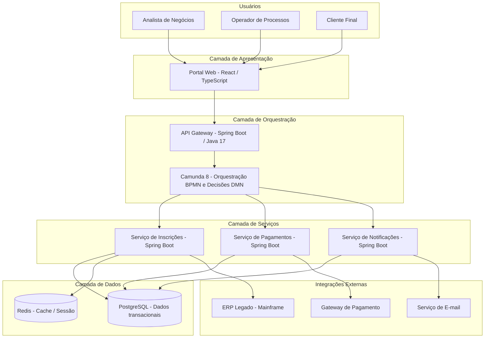
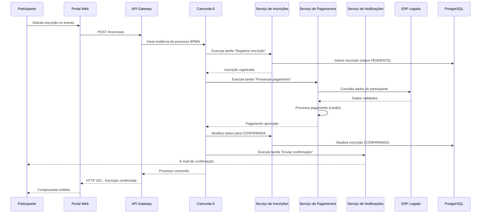

# Documentação de Arquitetura — Plataforma de Hiperautomação de Processos

## Descrição
Documentação de arquitetura produzida com a abordagem **diagrams as code** (Mermaid), como atividade prática da disciplina de Projeto e Arquitetura de Software com Apoio de IA Generativa. O repositório concentra a descrição do sistema em linguagem natural, diagramas estrutural (visão de containers inspirada no C4) e comportamental (sequência da jornada crítica), além das decisões e ajustes feitos sobre o que o modelo de IA gerou.

## Estrutura
documentacao-arquitetura-hiperautomacao/
├── README.md
└── docs/
    ├── descricao-sistema.md
    ├── diagrama-containers.mmd
    ├── diagrama-sequencia.mmd
    └── decisoes-ajustes.md

## Descrição do sistema (resumo)
Plataforma que orquestra processos de negócio (BPMN) e decisões automatizadas (DMN) com Camunda 8, integrando sistemas legados de forma incremental. Stack: Java 17, Spring Boot, Camunda 8, PostgreSQL, Redis, mensageria. Restrições: equipe pequena, LGPD, legado crítico.

## Diagramas

### Visão de Containers (estrutural)

### Jornada crítica: inscrição com pagamento e notificação (comportamental)

## Decisões e ajustes sobre o que o modelo gerou
Ver [docs/decisoes-ajustes.md](docs/decisoes-ajustes.md).

## Uso futuro como contexto para agentes
Este repositório foi pensado como base de documentação que pode servir de contexto para agentes de desenvolvimento implementarem o sistema com aderência à arquitetura documentada. Para isso, ainda faltam: contratos OpenAPI, ADRs, modelo de dados e políticas de integração (ver seção de lacunas na descrição).
